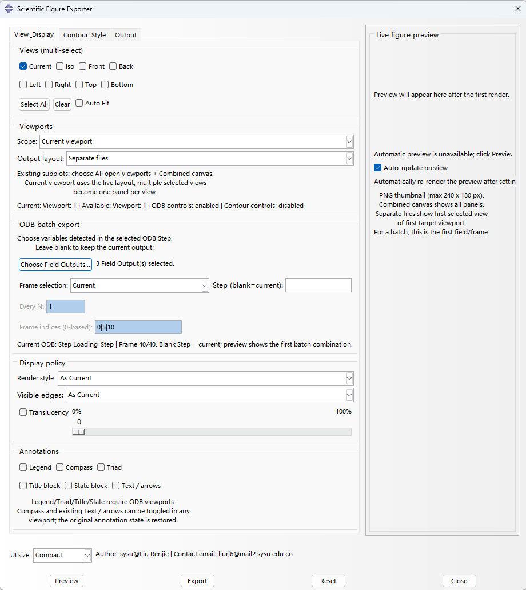
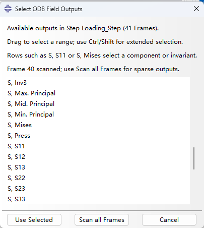

# Scientific Figure Exporter

Abaqus/CAE plug-in for composing viewport figures, previewing the rendered result, and exporting publication-ready images.

[English](#english) | [简体中文](#中文)

  

[Download V0.2 / 下载 V0.2](https://github.com/Liu-renjie/Scientific-Figure-Exporter/releases/tag/v0.2) · [Release notes / 更新说明](docs/releases/v0.2.md) · [Word user guide / Word 使用说明](docs/ScientificFigureExporter_User_Guide.docx)

## English

Scientific Figure Exporter helps prepare clean figures directly from Abaqus/CAE viewports. It supports standard views, existing multi-viewport layouts, display and contour styling, an in-dialog preview, and raster or vector export.

**Version:** V0.2
**Verified target:** Windows + Abaqus/CAE 2021 (embedded Python 2.7)
**Interface:** English

### Features

- **Choose views and arrange panels.** Use the current camera or standard views: Iso, Front, Back, Left, Right, Top, and Bottom. Export one viewport or all open viewports, as separate files or as one combined canvas.
- **Style the display.** Where supported by the target viewport, configure render style, visible edges, translucency, contour spectrum, interval count, and contour range.
- **Control annotations and background.** Toggle supported viewport decorations and existing Text / arrows annotations. Choose a solid, gradient, or no-viewport background; the Journal light and Presentation dark presets set background colors.
- **Preview before export.** The dialog includes a rendered PNG thumbnail and can refresh it automatically when settings change. The compact thumbnail is limited to 240 x 180 pixels; it is not the full-resolution output.
- **Compact single-screen UI.** The dialog keeps a resizable window, uses shorter wrapped labels, and provides Compact/Standard UI size presets at the bottom.
- **Set publication dimensions.** Choose an aspect ratio and pixel dimensions, or calculate the output size from publication width and DPI. Filename templates can include `{name}`, `{field}`, `{step}`, `{frame}`, `{view}`, and `{viewport}`.
- **Export common figure formats.** PNG, TIFF, and SVG are supported. JPG is supported on Windows through the built-in GDI+ encoder.
- **Batch Field Output export.** Open the field selector to read the available variable labels from the selected ODB Step. The initial scan checks the selected Step's current Frame so the dialog can open more promptly on large ODBs; use **Scan all Frames** when a sparse output is needed. Its extended-selection list supports mouse-drag range selection and Ctrl/Shift selection, so you are not limited to a built-in list of five variables. Export uses the same view, background, legend, resolution, and naming rules and validates every target Frame.
- **Batch Frame export.** For one Step, export the current, first, last, every-N, or specified 0-based Frame indices. This produces static loading, thermal, damage, or cure sequences; animation is intentionally not included in V0.2.




### Field components and performance

The Field Output selector now also lists available components and invariants,
for example `S, Mises`, `S, S11`, `S, S22`, `U, Magnitude`, and `U, U1`.
Choose several rows with drag selection or Ctrl/Shift. Subitems are discovered
from the ODB metadata and included in filenames, so components do not overwrite
one another. A plain variable row retains the existing automatic refinement.
The selector reads metadata through the kernel command; it does not transfer
ODB field values through the GUI proxy.

The export plan resolves filenames and Frame indices without loading every
FieldOutput. Availability is checked before the actual export writes images.
Preview validates and renders only its first field/Frame combination; all
selected combinations are checked for Export. Large meshes still incur native
Abaqus contour computation and rendering time.

### Important camera setting

**Auto Fit calls Abaqus' `fitView()` function and reframes the model.** If you have manually zoomed or panned and want to preserve that camera framing in Preview or the exported figure, turn Auto Fit off. Enable it only when you want Abaqus to fit the displayed model to the viewport.

### Installation

1. Close Abaqus/CAE before installing or updating the plug-in.
2. Download and extract the **Scientific-Figure-Exporter-V0.2.zip** asset from the [V0.2 release](https://github.com/Liu-renjie/Scientific-Figure-Exporter/releases/tag/v0.2), or clone this repository.
3. Open a command prompt in the extracted repository folder and run:

   ```powershell
   python install_plugin.py
   ```

   The installer uses only the Python standard library and works with Python 2.7 or Python 3. It copies the six runtime modules to `%USERPROFILE%\abaqus_plugins\ScientificFigureExporter` and creates timestamped backups of files it replaces.

4. Start Abaqus/CAE and open **Plug-ins > Scientific Figure Exporter...**.

You can install manually instead: copy `scientificFigureExporter_plugin.py`, `scientificFigureExporter_form.py`, `scientificFigureExporter_kernel.py`, `scientificFigureExporter_state.py`, `scientificFigureExporter_jpeg.py`, and `colorMaps.py` together into `%USERPROFILE%\abaqus_plugins\ScientificFigureExporter`. Restart Abaqus/CAE after copying. Keep the module names unchanged and keep all six files in the same folder.

### Typical workflows

**Combine viewports that are already arranged in Abaqus/CAE:** arrange the viewports first, select **Current**, set **Scope** to **All open viewports**, and set **Output layout** to **Combined canvas**. Turn **Auto Fit** off to preserve manually adjusted cameras. Preview the canvas, then export.

When **Export** is clicked, a read-only export plan table is shown before any file is written. It lists the resolved Field Output, Step, Frame, viewport/view, and filename for every planned image, and marks how many existing outputs will be overwritten. Confirm the table to start the export, or cancel to return to the plug-in.

**Create a panel of standard views from one viewport:** select **Current viewport**, choose multiple views, and set **Output layout** to **Combined canvas**. Combining multiple selected views with **All open viewports** is not supported; choose one view for that scope.

Preview temporarily applies display settings. Use **Reset** or close the dialog to return to the pre-preview state. The final export uses the settings in the Output tab; the preview remains a small PNG thumbnail regardless of the selected output format.

### Formats and limitations

- **PNG, TIFF, SVG:** exported through Abaqus/CAE's print-to-file support.
- **JPG:** Windows only. The plug-in renders through PNG and converts with Windows GDI+ at quality 95. JPEG has no alpha channel, so transparent pixels are composited over white.
- **EPS:** not included in this release.
- **Contour controls:** available only when the target viewport displays a compatible ODB contour plot. In multi-viewport scope, every target viewport must satisfy the relevant conditions. Disabled contour settings are left unchanged and do not block a valid non-contour export.
- **Text / arrows:** toggles annotations that already exist in the model or ODB; it does not create new annotations.
- **Combined canvas:** with **All open viewports**, select one view at a time. Multiple standard views can be combined when using **Current viewport** scope.
- **Static ODB batches:** click **Choose Field Outputs...** to scan the selected Step's current Frame (the current Step when the Step field is blank). If an unusual ODB has a field that appears only in another Frame, click **Scan all Frames** in the selector. The list supports drag-selection of ranges and Ctrl/Shift multi-selection. Leave the selection blank to keep the current primary variable. Export validates that every selected variable exists in each Frame being exported. Frame indices are 0-based; **Every N** also includes the final Frame.
- **Batch filenames:** the existing `{name}_{view}` default is preserved for single exports. When a Field Output or non-current Frame selection is active, missing `{field}`, `{step}`, and `{frame}` tokens are inserted automatically to prevent overwriting; you can also place these tokens explicitly in the naming template.
- **Export plan:** the confirmation table is read-only and does not write a CSV. The actual exporter still applies the same existing overwrite behavior after confirmation.
- **Abaqus compatibility:** only Windows with Abaqus/CAE 2021 has been verified. Other Abaqus versions and operating systems have not been tested.

### Troubleshooting

- **The plug-in is missing from the Plug-ins menu:** verify that all six runtime `.py` files are together in the user plug-ins directory, then restart Abaqus/CAE.
- **The model recenters or changes zoom:** turn off **Auto Fit** to preserve the manually selected camera framing.
- **Contour controls are disabled:** switch the target viewport to a supported ODB contour display; the available controls depend on the displayed object and plot type.
- **Several viewports export as separate images:** set **Output layout** to **Combined canvas** and confirm **Scope** is **All open viewports**.
- **JPG is unavailable or fails:** JPG conversion requires Windows GDI+. Use PNG, TIFF, or SVG on other platforms.

For a problem report, include your Abaqus/CAE version, Windows version, the steps to reproduce, and the relevant Abaqus Error Log message. Remove personal paths and proprietary model data before attaching screenshots or logs. Please do not upload `.cae` or `.odb` files to an issue.

### Repository contents

- `scientificFigureExporter_plugin.py` — Abaqus menu registration
- `scientificFigureExporter_form.py` — plug-in dialog and controls
- `scientificFigureExporter_kernel.py` — preview and export operations
- `scientificFigureExporter_state.py` — viewport/session state snapshot and restore
- `scientificFigureExporter_jpeg.py` — Windows GDI+ PNG-to-JPG conversion
- `colorMaps.py` — contour palette definitions
- `install_plugin.py` — user-level installer
- `docs/ScientificFigureExporter_User_Guide.docx` — Chinese user guide

### License, attribution, and disclaimer

Released under the [MIT License](LICENSE). Abaqus is a product of Dassault Systèmes and is not included with this plug-in. This project is independent and is not affiliated with or endorsed by Dassault Systèmes. Use requires a separately installed, properly licensed Abaqus/CAE.

Author: **sysu@Liu Renjie**  
Contact: [liurj6@mail2.sysu.edu.cn](mailto:liurj6@mail2.sysu.edu.cn)
This plugin is completely free; if you find it useful, simply offer a silent word of thanks to the author.
If you paid someone to obtain this plugin, or encounter links selling it, please contact the author.

## 中文

Scientific Figure Exporter 是一个 Abaqus/CAE 插件，用于整理视口、预览渲染效果，并导出适合论文和报告使用的图像。插件支持标准视图、已有的多视口布局、显示与等值线样式设置，以及栅格和矢量格式输出。

**版本：** V0.2
**验证环境：** Windows + Abaqus/CAE 2021（内置 Python 2.7）
**插件界面：** 英文

### 功能特点

- **视图与子图布局：** 使用当前视角，或选择 Iso、Front、Back、Left、Right、Top、Bottom 等标准视图。可导出单个视口或全部打开的视口，也可分别输出或合并到同一画布。
- **显示样式：** 在目标视口支持的情况下，可设置渲染样式、可见边、透明度，以及 ODB 等值线色谱、区间数和范围。
- **背景与标注：** 可切换支持的视口装饰及模型/ODB 中已有的 Text / arrows 标注。背景支持纯色、渐变或无视口背景；Journal light 和 Presentation dark 预设可快速设置底色。
- **渲染预览：** 对话框内显示 PNG 预览图，并可在设置变化后自动更新。为减少窗口占用，预览最大为 240 x 180 像素，仅用于检查构图，不代表最终输出分辨率。
- **紧凑单屏界面：** 窗口仍可拖动调整大小，长说明会自动换行，底部提供 Compact/Standard 两种界面尺寸预设。
- **出版尺寸：** 可指定宽高比和像素尺寸，也可按出版宽度与 DPI 计算输出尺寸。文件名模板支持 `{name}`、`{field}`、`{step}`、`{frame}`、`{view}` 和 `{viewport}` 字段。
- **常用图像格式：** 支持 PNG、TIFF、SVG；Windows 下还支持通过系统 GDI+ 转换的 JPG。
- **批量导出 Field Output：** 点击 **Choose Field Outputs...** 后，插件通过内核读取所选 Step 当前帧的场变量、分量与不变量，例如 `S, Mises`、`S, S11`、`U, U1`；可用 **Scan all Frames** 查找只在其他帧出现的字段。列表支持拖选及 Ctrl/Shift 多选。输出沿用同一视角、背景、Legend、分辨率和命名规则。
- **批量导出 Frame：** 在一个 Step 下可选择当前帧、首帧、末帧、每隔 N 帧或指定的 0-based 帧索引，用于生成加载、温度、损伤或固化过程的静态序列图；V0.2 暂不生成动画。

### 场变量分量与性能

场变量列表包含 ODB 中可用的分量和不变量，例如 `S, Mises`、`S, S11`、`U, Magnitude`、`U, U1`，支持拖选和 Ctrl/Shift 多选。子项会写入文件名，避免不同分量互相覆盖。单独选择变量名时沿用自动分量规则。

列表通过内核命令读取元数据，不通过 GUI 代理传输 ODB 场数据；默认只扫描当前帧，可按需扫描全部帧。导出计划只计算帧索引和文件名，正式导出写图前再检查变量及子项。Preview 只检查并渲染首个变量/帧组合，Export 检查全部组合。大模型仍需要 Abaqus 本身进行等值线计算和渲染，不能保证所有 ODB 都能即时响应。

本轮公开版本统一为 **V0.2**（Git 标签 `v0.2`）；之前的内部开发标记 v1.2 不代表已发布的 GitHub 版本。旧的 v0.1 标签和发布保留不变。

### 关于 Auto Fit

**Auto Fit 会调用 Abaqus 的 `fitView()` 自动适配视图，重新调整模型的缩放和位置。** 如果已经手动缩放或平移模型，并希望预览或导出时保留该视角，请关闭 Auto Fit；只有需要让 Abaqus 自动将模型适配到视口时才启用它。

### 安装方法

1. 安装或更新插件前，先关闭 Abaqus/CAE。
2. 从 [V0.2 发布页](https://github.com/Liu-renjie/Scientific-Figure-Exporter/releases/tag/v0.2) 下载 **Scientific-Figure-Exporter-V0.2.zip** 并解压，或克隆本仓库。
3. 在发布目录打开命令行并运行：

   ```powershell
   python install_plugin.py
   ```

   安装器只使用 Python 标准库，可由 Python 2.7 或 Python 3 运行。它会将六个运行模块复制到 `%USERPROFILE%\abaqus_plugins\ScientificFigureExporter`；替换同名文件前会创建带时间戳的备份。

4. 启动 Abaqus/CAE，从 **Plug-ins > Scientific Figure Exporter...** 打开插件。

也可以手动安装：将 `scientificFigureExporter_plugin.py`、`scientificFigureExporter_form.py`、`scientificFigureExporter_kernel.py`、`scientificFigureExporter_state.py`、`scientificFigureExporter_jpeg.py` 和 `colorMaps.py` 一起复制到 `%USERPROFILE%\abaqus_plugins\ScientificFigureExporter`，然后重启 Abaqus/CAE。请保持文件名不变，并确保六个文件位于同一目录。

### 常见操作流程

**合并已经排好的多个视口：** 先在 Abaqus/CAE 中排好视口，插件中选择 **Current**，将 **Scope** 设为 **All open viewports**，将 **Output layout** 设为 **Combined canvas**。如需保留手动调整的视角，请关闭 **Auto Fit**。预览确认后再导出。

点击 **Export** 后，插件会在真正写文件之前显示只读的导出计划表，列出每一张图解析后的 Field Output、Step、Frame、视口/视图和文件名，并提示已有文件数量。确认后才开始导出，取消则返回插件；本轮不生成导出后 CSV。

**将一个视口的多个标准视图合并成子图：** 选择 **Current viewport**，勾选多个视图，并将 **Output layout** 设为 **Combined canvas**。在 **All open viewports** 范围下不能同时组合多个标准视图；该范围每次只能选择一个视图。

Preview 会临时应用显示设置。点击 **Reset** 或关闭对话框可恢复预览前的状态。正式输出按 Output 标签页中的设置生成；无论最终格式为何，窗格预览始终是低分辨率 PNG 缩略图。

### 格式与限制

- **PNG、TIFF、SVG：** 通过 Abaqus/CAE 的 print-to-file 功能导出。
- **JPG：** 仅限 Windows。插件先由 Abaqus 输出 PNG，再通过 Windows GDI+ 以质量 95 转换。JPEG 不支持透明通道，透明像素会铺白。
- **EPS：** 本版本未开放该格式。
- **等值线控件：** 仅当目标视口显示兼容的 ODB 等值线图时可用。多视口模式下，相关设置要求所有目标视口都满足条件；控件禁用时不会阻止模型或非等值线图导出。
- **Text / arrows：** 只控制模型或 ODB 中已经存在的文字/箭头标注，不会创建新标注。
- **Combined canvas：** 使用 **All open viewports** 时一次只能选择一个视图；要合并多个标准视图，请使用 **Current viewport**。
- **静态批量输出：** 点击 **Choose Field Outputs...** 后，默认快速扫描所选 Step（Step 留空时为当前 Step）的当前帧；如果场变量只在其他帧出现，可在选择器中点击 **Scan all Frames** 完整扫描。列表支持鼠标拖选范围以及 Ctrl/Shift 多选。不选择字段时保留当前主变量。导出前会检查每个目标帧是否都包含所选变量。帧索引从 0 开始，**Every N** 会额外包含末帧。
- **批量文件名：** 单图输出继续保留 `{name}_{view}` 默认规则。选择 Field Output 或非当前帧模式后，若模板缺少 `{field}`、`{step}`、`{frame}`，插件会自动插入相应字段以避免覆盖；也可以在模板中手动使用这些字段。
- **导出计划表：** 该表只用于导出前确认，不会生成 CSV；确认后仍沿用现有的文件覆盖行为。
- **Abaqus 版本：** 目前只验证了 Windows + Abaqus/CAE 2021；其他版本和操作系统尚未验证。

### 常见问题

- **Plug-ins 菜单中没有插件：** 检查六个运行 `.py` 文件是否都在用户插件目录且没有分散到子目录中，然后重启 Abaqus/CAE。
- **模型缩放或位置被重新调整：** 关闭 **Auto Fit**，以保留手动设置的视角。
- **等值线选项不可用：** 将目标视口切换到支持的 ODB 等值线显示；控件可用性取决于视口对象和绘图类型。
- **多个视口被分别导出：** 将 **Output layout** 改为 **Combined canvas**，并确认 **Scope** 为 **All open viewports**。
- **JPG 不可用或转换失败：** JPG 需要 Windows GDI+；其他平台可选择 PNG、TIFF 或 SVG。

提交问题时，请提供 Abaqus/CAE 版本、Windows 版本、复现步骤和相关 Abaqus Error Log 信息。附加截图或日志前请移除个人路径及专有模型数据；请勿在 Issue 中上传 `.cae` 或 `.odb` 文件。

### 仓库文件

- `scientificFigureExporter_plugin.py`：注册 Abaqus 插件菜单
- `scientificFigureExporter_form.py`：插件对话框和控件
- `scientificFigureExporter_kernel.py`：预览和导出操作
- `scientificFigureExporter_state.py`：视口/会话状态保存与恢复
- `scientificFigureExporter_jpeg.py`：Windows GDI+ PNG 转 JPG
- `colorMaps.py`：等值线调色板定义
- `install_plugin.py`：当前用户级安装器
- `docs/ScientificFigureExporter_User_Guide.docx`：中文使用说明

### 许可、署名与免责声明

本项目采用 [MIT License](LICENSE)。Abaqus 属于 Dassault Systèmes，软件本身不包含在本插件中。本项目独立开发，与 Dassault Systèmes 无隶属或背书关系。使用本插件需要用户自行安装并持有合法授权的 Abaqus/CAE。

作者：**sysu@刘仁杰**  
联系邮箱：[liurj6@mail2.sysu.edu.cn](mailto:liurj6@mail2.sysu.edu.cn)
此插件完全免费，若对您有用仅需默念谢谢作者 :)
如果您在其他人手中付费获得此插件，或遇见售卖该插件的链接，请联系作者。

